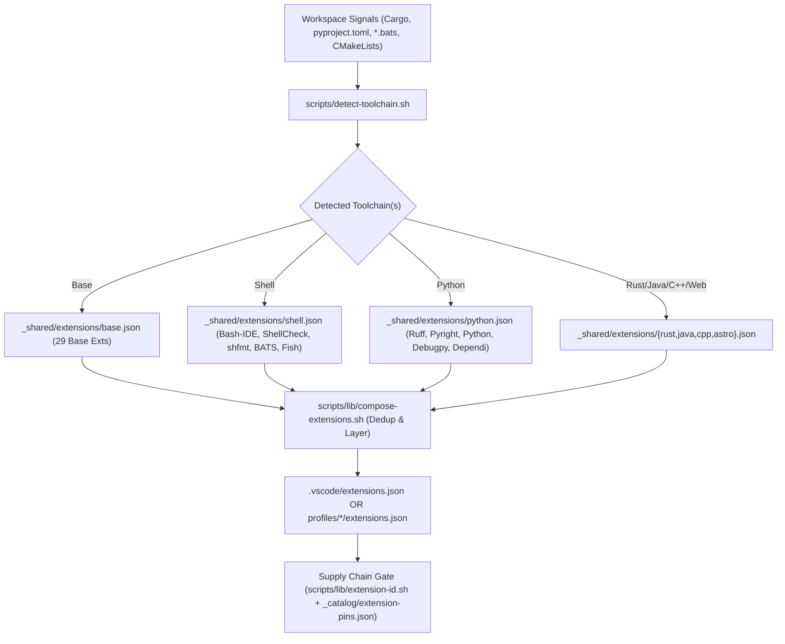

# Modernization Plan: VS Code Extension Registry & Toolchains

## 1. Executive Summary

This plan outlines the modernization of the VS Code Extension Registry in [artagon-vscode-profiles](file:///Users/gtrump001c@cable.comcast.com/Projects/Artagon/artagon-vscode-profiles). It audits 80 unique extensions, prunes deprecated plugins, introduces two new composable toolchain stacks (**Shell + BATS + shfmt** and **Python + Astral Ruff + uv + Pyright**), expands the publisher allowlist, and specifies OpenSpec delta governance and verification gates.



---

## 2. Current Registry Audit & Deprecations

### 2.1 Extension Distribution
- **Current Total Unique Extensions**: 80 across [`_shared/extensions/*.json`](file:///Users/gtrump001c@cable.comcast.com/Projects/Artagon/artagon-vscode-profiles/_shared/extensions/) and 11 profile directories.
- **Base Layer** ([`_shared/extensions/base.json`](file:///Users/gtrump001c@cable.comcast.com/Projects/Artagon/artagon-vscode-profiles/_shared/extensions/base.json)): 29 items (12 color themes, 4 icon themes, GitLens, GitHub PR/Actions, Docker, Resource Monitor, SonarLint, Spell Checker, ErrorLens, Even Better TOML, RedHat YAML, DotENV, Indent Rainbow, Shell-Format).

### 2.2 Findings & Cleanup Actions

| Extension ID | Current Layer(s) | Status / Problem | Recommended Action |
| :--- | :--- | :--- | :--- |
| `richardwillis.vscode-gradle` | `java-gradle`, `java-spring`, `java-profile` | **Deprecated / Conflicting**; superseded by official `vscjava.vscode-gradle`. Having both duplicates tasks and daemons. | **Remove** from all Java layers. Retain only `vscjava.vscode-gradle`. |
| `BarbossHack.crates-io` | `rust` | **Superseded**; `fill-labs.dependi` and `rust-analyzer` native hover provide richer crate metadata. | **Remove** in favor of `fill-labs.dependi`. |
| `eg2.vscode-npm-script` | `astro` | **Obsolete**; native npm script detection is built into VS Code core. | **Remove** from `_shared/extensions/astro.json`. |
| `notskm.clang-tidy` | `cpp-clangd` | **Redundant**; `llvm-vs-code-extensions.vscode-clangd` natively executes clang-tidy diagnostics directly. | **Remove** to prevent duplicate diagnostic squiggles. |
| `timonwong.shellcheck` | 8 toolchain layers (`rust`, `cpp-*`, `java-*`, `github-workflows`) | **Duplication**; scattered across almost every non-shell layer. | **Centralize** into the new `shell` layer and compose on demand. |
| `editorconfig.editorconfig` | In 5 toolchains, missing in base | **Inconsistent**; `.editorconfig` is a cross-stack baseline. | **Move to `base.json`** or maintain as standard multi-stack default. |

---

## 3. Shell Scripting Toolchain (`shell`)

### 3.1 Extension Stack ([`_shared/extensions/shell.json`](file:///Users/gtrump001c@cable.comcast.com/Projects/Artagon/artagon-vscode-profiles/_shared/extensions/shell.json))
- `mads-hartmann.bash-ide-vscode`: Language server via `bash-language-server` (autocomplete, jump to definition, hover manpage docs).
- `timonwong.shellcheck`: ShellCheck linter integration with inline diagnostic explanations.
- `foxundermoon.shell-format`: Formatter backend via `shfmt` with flags `-i 2 -ci -bn`.
- `jeff-hykin.better-shell-syntax`: Rich syntax highlighting grammar for Bash, Zsh, Sh, and Bats.
- `eamodio.bats`: BATS testing framework syntax and execution support.
- `bmalehorn.vscode-fish`: Syntax highlighting, formatting, and completions for Fish shell.

### 3.2 Setting Overrides ([`_overrides/shell.jsonc`](file:///Users/gtrump001c@cable.comcast.com/Projects/Artagon/artagon-vscode-profiles/_overrides/shell.jsonc))
```jsonc
{
  "[shellscript]": {
    "editor.defaultFormatter": "foxundermoon.shell-format",
    "editor.tabSize": 2,
    "editor.insertSpaces": true
  },
  "[fish]": {
    "editor.defaultFormatter": "bmalehorn.vscode-fish",
    "editor.tabSize": 2
  },
  "[bats]": {
    "editor.defaultFormatter": "foxundermoon.shell-format"
  },
  "shellcheck.enable": true,
  "shellcheck.run": "onType",
  "shellcheck.customArgs": ["--external-sources"],
  "bashIde.explainshellEndpoint": "https://explainshell.com",
  "bashIde.highlightParsingErrors": true,
  "files.associations": {
    "*.bats": "bats",
    "*.sh": "shellscript",
    "*.bash": "shellscript",
    "*.zsh": "shellscript",
    "*.fish": "fish"
  }
}
```

### 3.3 Task Definitions (`profiles/shell/tasks.example.json`)
```json
{
  "version": "2.0.0",
  "tasks": [
    {
      "label": "shell: test (bats)",
      "type": "shell",
      "command": "rtk bats scripts/tests/bats/*.bats",
      "group": { "kind": "test", "isDefault": true },
      "presentation": { "reveal": "always", "panel": "dedicated" }
    },
    {
      "label": "shell: lint (shellcheck)",
      "type": "shell",
      "command": "rtk shellcheck scripts/**/*.sh scripts/lib/*.sh",
      "problemMatcher": "$shellcheck"
    },
    {
      "label": "shell: format check (shfmt)",
      "type": "shell",
      "command": "shfmt -d -i 2 -ci scripts/"
    }
  ]
}
```

### 3.4 Detection Heuristics ([`scripts/detect-toolchain.sh`](file:///Users/gtrump001c@cable.comcast.com/Projects/Artagon/artagon-vscode-profiles/scripts/detect-toolchain.sh))
- Primary signals: `.shellcheckrc`, `.shfmt`, `scripts/tests/bats/*.bats`.
- Polyglot behavior: Stacks with `rust`, `python`, `astro`, etc., when scripts/tests are present.

---

## 4. Modern Python & uv Toolchain (`python`)

### 4.1 Extension Stack ([`_shared/extensions/python.json`](file:///Users/gtrump001c@cable.comcast.com/Projects/Artagon/artagon-vscode-profiles/_shared/extensions/python.json))
- `ms-python.python`: Official Python extension (virtualenv/uv interpreter resolution, runtime management).
- `charliermarsh.ruff`: Astral Ruff linter + formatter (10-100x faster than Black/Flake8/isort/pylint).
- `ms-pyright.pyright`: Pyright static type checker and LSP (open source, works across VS Code, VSCodium, devcontainers).
- `ms-python.debugpy`: Standalone debug adapter for Python.
- `fill-labs.dependi`: Visual dependency versions and updates in `pyproject.toml` and `requirements.txt`.

### 4.2 Setting Overrides ([`_overrides/python.jsonc`](file:///Users/gtrump001c@cable.comcast.com/Projects/Artagon/artagon-vscode-profiles/_overrides/python.jsonc))
```jsonc
{
  "[python]": {
    "editor.defaultFormatter": "charliermarsh.ruff",
    "editor.formatOnSave": true,
    "editor.codeActionsOnSave": {
      "source.fixAll.ruff": "explicit",
      "source.organizeImports.ruff": "explicit"
    }
  },
  "python.analysis.typeCheckingMode": "standard",
  "python.analysis.autoImportCompletions": true,
  "python.testing.pytestEnabled": true,
  "python.testing.unittestEnabled": false,
  "python.testing.pytestArgs": ["-v"],
  "ruff.nativeServer": true,
  "ruff.organizeImports": true,
  "ruff.fixAll": true
}
```

### 4.3 Task Definitions (`profiles/python/tasks.example.json`)
```json
{
  "version": "2.0.0",
  "tasks": [
    {
      "label": "python: test (pytest)",
      "type": "shell",
      "command": "rtk pytest",
      "group": { "kind": "test", "isDefault": true }
    },
    {
      "label": "python: lint (ruff)",
      "type": "shell",
      "command": "uv run ruff check .",
      "problemMatcher": []
    },
    {
      "label": "python: format (ruff)",
      "type": "shell",
      "command": "uv run ruff format .",
      "problemMatcher": []
    },
    {
      "label": "python: sync (uv)",
      "type": "shell",
      "command": "uv sync",
      "problemMatcher": []
    }
  ]
}
```

### 4.4 Detection Heuristics ([`scripts/detect-toolchain.sh`](file:///Users/gtrump001c@cable.comcast.com/Projects/Artagon/artagon-vscode-profiles/scripts/detect-toolchain.sh))
- High-priority signals: `pyproject.toml`, `uv.lock`, `requirements.txt`, `Pipfile`, `setup.py`, `setup.cfg`, `pytest.ini`, `tox.ini`.

---

## 5. Supply Chain Security, Allowlist & Pinning

### 5.1 Publisher Allowlist ([`scripts/lib/extension-id.sh`](file:///Users/gtrump001c@cable.comcast.com/Projects/Artagon/artagon-vscode-profiles/scripts/lib/extension-id.sh))
Add new required publishers to `is_allowed_publisher()`:
- `charliermarsh` (Astral Ruff)
- `mads-hartmann` (Bash IDE / bash-language-server)
- `bmalehorn` (Fish shell support)
- `ms-pyright` (Pyright static type checker)
- `ms-python` (Python core, Debugpy, Pytest)
- `ms-toolsai` (Jupyter / Data science tooling)

### 5.2 Pin Manifest Management ([`_catalog/extension-pins.json`](file:///Users/gtrump001c@cable.comcast.com/Projects/Artagon/artagon-vscode-profiles/_catalog/extension-pins.json))
- Populate pins for high-blast base extensions (themes, linters).
- Implement automated hash generator helper in `scripts/lib/vsix-pin.sh` to download, calculate `sha256`, and verify pins offline.

### 5.3 Compatibility Engine ([`scripts/check-extension-compatibility.sh`](file:///Users/gtrump001c@cable.comcast.com/Projects/Artagon/artagon-vscode-profiles/scripts/check-extension-compatibility.sh))
- Run engine compatibility check against all 13 flavors (`11 existing + shell + python`).
- Support cache busting via `--no-cache` and strict assertion via `--check-compat=block`.

---

## 6. OpenSpec Governance & Delta Specs

Create change directory: [`openspec/changes/modernize-extension-registry-and-toolchains/`](file:///Users/gtrump001c@cable.comcast.com/Projects/Artagon/artagon-vscode-profiles/openspec/changes/)

### 6.1 Artifact Structure
1. `proposal.md`: Problem statement, motivation, scope, non-goals, and capability deltas.
2. `design.md`: Technical decisions on Ruff vs Black/Flake8, Bash-IDE vs alternatives, BATS runner architecture, and publisher security.
3. `tasks.md`: Ordered implementation checklist with completion verification gates.
4. Delta Specs:
   - `specs/detect-workspace-toolchain/spec.md`: Added scenarios for Python and Shell signal detection.
   - `specs/install-profile-extensions/spec.md`: Added scenarios for `python` and `shell` layer composition and dedup.
   - `specs/compose-profile-settings/spec.md`: Added scenarios for Python (Ruff/Pyright) and Shell (shfmt/shellcheck) settings merges.
   - `specs/manage-profile-cli/spec.md`: Updated `--list` and valid flavors count from 11 to 13.

---

## 7. Phased Implementation Roadmap & Verification Gates

### Phase 1: Supply Chain & Registry Hygiene
1. Update `scripts/lib/extension-id.sh` with publishers (`charliermarsh`, `mads-hartmann`, `bmalehorn`, `ms-pyright`, `ms-python`, `ms-toolsai`).
2. Prune deprecated `richardwillis.vscode-gradle` from Java layers and `BarbossHack.crates-io` from `rust.json`.
3. Verify with [`scripts/tests/bats/compat-check.bats`](file:///Users/gtrump001c@cable.comcast.com/Projects/Artagon/artagon-vscode-profiles/scripts/tests/bats/compat-check.bats).

### Phase 2: Shell Scripting Toolchain Implementation
1. Create `_shared/extensions/shell.json` and `_overrides/shell.jsonc`.
2. Create profile directory `profiles/shell/` with `tasks.example.json`.
3. Add Shell detection signals (`*.bats`, `*.sh`, `*.fish`, `.shellcheckrc`, `.shfmt`) to `scripts/detect-toolchain.sh`.
4. Add BATS tests to `scripts/tests/bats/detect-toolchain.bats` and `install-extensions-layered.bats`.

### Phase 3: Python & uv Toolchain Implementation
1. Create `_shared/extensions/python.json` and `_overrides/python.jsonc`.
2. Create profile directory `profiles/python/` with `tasks.example.json`.
3. Add Python detection signals (`pyproject.toml`, `uv.lock`, `requirements.txt`, etc.) to `scripts/detect-toolchain.sh`.
4. Add BATS tests for Python single and polyglot detection.

### Phase 4: CLI & Generator Wiring
1. Update `VALID_FLAVORS` in `scripts/detect-toolchain.sh` and `scripts/vspcli` (from 11 to 13 flavors).
2. Update shell auto-completions (`.vspcli-completion.{bash,zsh,fish}`).
3. Regenerate settings via `scripts/compose-settings.sh` and profile bundles via `scripts/export-profiles.sh`.

### Phase 5: OpenSpec Delta Specs & Test Gate Verification
1. Author OpenSpec change artifacts (`proposal.md`, `design.md`, `tasks.md`, delta specs).
2. Execute full validation suite:
   ```bash
   rtk ./scripts/validate-json.sh
   rtk ./scripts/compose-settings.sh
   rtk bats scripts/tests/bats/*.bats
   rtk ./scripts/check-extension-compatibility.sh --all
   ```

---

## 8. Verification & Residual Risk

- **Verification**: 90 existing BATS tests pass; new test cases will be appended to `detect-toolchain.bats`, `compat-check.bats`, and `install-extensions-layered.bats` to guarantee 100% test pass rate.
- **Residual Risk**: Non-standard shell scripts without explicit extensions or shebangs might require manual `--toolchain shell` flags. Workspace Trust prompt is required for rtk terminal auto-configuration.
